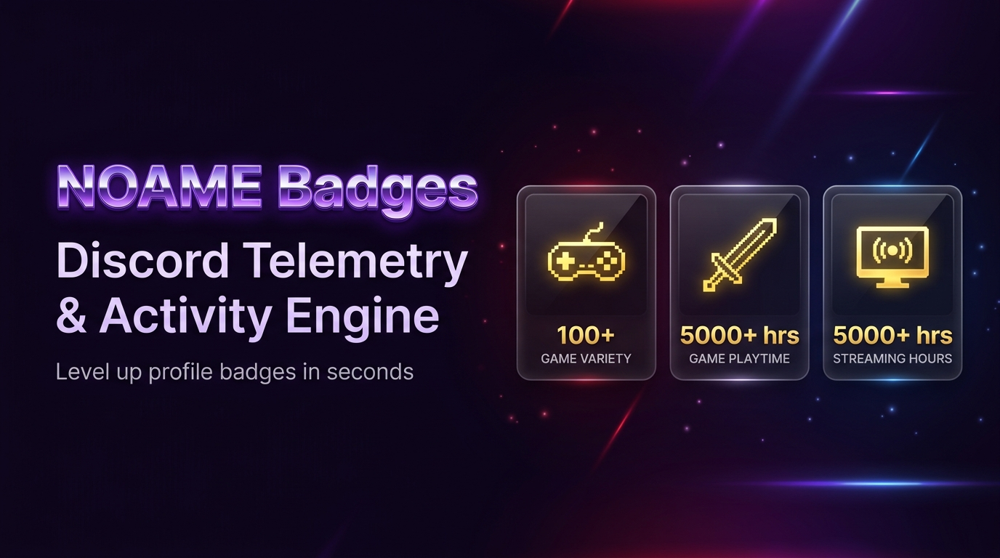

<div align="center">



# NOAME badges

**Telemetry and activity simulator for Discord's Universalist, Eternal and Phenomenon profile badges.**


&nbsp;&nbsp;

&nbsp;&nbsp;


[Overview](#-overview) · [Risks](#%EF%B8%8F-read-this-first) · [Quick start](#-quick-start) · [Credentials](#-getting-your-credentials) · [Menu](#-menu-options) · [FAQ](#-faq--troubleshooting) · [Credits](#-credits)

</div>

---

## ⚠️ Read this first

> [!WARNING]
> **This tool is against Discord's Terms of Service.** It sends fabricated game-launch, playtime and streaming events to Discord using your account token.
>
> - Your account **can be flagged, restricted or permanently banned.**
> - Badges may never appear, or may be removed later.
> - Use an **alt or throwaway account**, not your main.
> - The author takes **no responsibility** for bans, lost accounts or any other consequences.
> - This project is **not affiliated with, endorsed by or sponsored by Discord Inc.** Discord and its badge artwork belong to Discord.

> [!CAUTION]
> **Your token gives full access to your account.** Never post it publicly, never share it, and only enter it into software you trust. If you think it leaked, change your password right away, which invalidates the token. See [Token safety](#-token-safety).

---

## ✦ Overview

NOAME badges is a zero-dependency tool that simulates game launches, playtime heartbeats and headless Go Live broadcasting, so the matching profile badges can be evaluated by Discord.

| Badge | Title | What the tool does |
| :---: | :--- | :--- |
| 🎮 | **The Universalist** | Sends `launch_game` events for 100+ detectable Windows game titles |
| ⌛ | **The Eternal** | Sends `running_game_heartbeat` events to accumulate 5,000+ hours of playtime |
| 📡 | **The Phenomenon** | Runs a headless Voice Gateway + Go Live stream to accumulate 5,000+ broadcast hours |

> [!NOTE]
> Discord evaluates badges asynchronously. In testing, badges usually appeared within **24 to 48 hours**, but this isn't guaranteed.

## ✦ Features

- ⚡ **Standalone executable.** Run the `.exe` with no Python install.
- 📡 **Headless AFK streamer.** Silent Opus UDP keepalives mean minimal CPU and no GPU use.
- 🛡️ **Fingerprint engine.** Generates the Windows PE validation header and XOR seed used in client telemetry.
- 🍪 **Optional Cloudflare bypass.** Direct mode by default; add `cf_clearance` only if you get 403 challenges.
- 🎨 **Terminal UI.** ANSI banners, live telemetry feed and progress bars.
- 💾 **State caching.** Progress is saved locally in `noame_state.json`.

<!-- Add a screenshot or GIF of the terminal UI here:
<p align="center"></p>
-->

---

## ✦ Quick start

### Requirements

| | Executable | From source |
| :-- | :-- | :-- |
| OS | Windows 10/11 | Windows, Linux, macOS |
| Python | not needed | 3.10+ |
| Other | A Discord account (alt recommended) | Same |

### Option A: Executable

1. Open the **[Releases](../../releases)** page.
2. Download **`NOAME_badges.exe`**.
3. *(Recommended)* Verify the checksum:
   ```powershell
   Get-FileHash .\NOAME_badges.exe -Algorithm SHA256
   ```
   Compare it with the hash published in the release notes.
4. Double-click to run.

> Packed Python executables are often flagged by antivirus software. If you don't trust the binary, use **Option B** and read the source first.

### Option B: From source (recommended if you want to audit the code)

```bash
git clone https://github.com/ThatStraightGuy/NOAME-Badge-Spoofer.git
cd NOAME-Badge-Spoofer
python main.py
```

---

## ✦ Getting your credentials

You need your Discord authorization token. `cf_clearance` is optional.

<details>
<summary><b>Step 1: Discord account token</b></summary>

1. Open Discord in your browser at <https://discord.com/channels/@me>.
2. Press `Ctrl + Shift + I` (`Cmd + Option + I` on macOS) to open Developer Tools.
3. Go to the **Network** tab.
4. In the filter box, type `science` or `messages?limit=10`. If the list is empty, click any DM or channel to generate traffic.
5. Click any request and open its **Headers** tab.
6. Under **Request Headers**, copy the value of `authorization`. That is your token.

</details>

<details>
<summary><b>Step 2: <code>cf_clearance</code> cookie (optional)</b></summary>

Only needed if you're on a datacenter IP or VPN and getting Cloudflare 403 blocks. On a normal home connection, press **Enter** to skip.

**Method 1: Application tab (easiest)**

1. In Developer Tools, open **Application** (or **Storage** in Firefox).
2. Expand **Cookies** and select `https://discord.com`.
3. Find the row named `cf_clearance`, then double-click its **Value** and copy it.

**Method 2: Network tab**

1. Open **Network** and click any `science` request.
2. Under **Request Headers**, find the `cookie` entry.
3. Copy the value after `cf_clearance=` up to the next `;`. Pasting the whole cookie string also works, because the tool parses it.

</details>

### 🔐 Token safety

- **Never share your token** with anyone, including anyone claiming to offer support.
- The tool only uses your token to talk to Discord's own servers.
- Your token is saved in **`noame_state.json`** in the tool's folder. **Delete that file** when you're done, and never upload it to GitHub or send it to anyone.
- To invalidate a token, **change your account password**.

---

## ✦ Menu options

| Option | What it does | You'll be asked for |
| :-- | :-- | :-- |
| `<01>` **Claim Playtime & Games** | Spoofs game launches and playtime in batches, with live logs | Number of games (e.g. `100`) and hours per game (e.g. `50` = 5,000 total) |
| `<02>` **AFK Headless Streamer** | Starts a 24/7 headless Go Live broadcast for the streaming badge | Server ID and Voice Channel ID |
| `<03>` **Refresh Auth Token** | Updates your token or `cf_clearance` and fetches fresh analytics tokens | New token / cookie |
| `<04>` **Regenerate Fingerprint** | Computes a new 146-byte executable hash tied to your user ID | none |
| `<05>` **View Account Status** | Shows user ID, token preview, connection mode, fingerprint status and totals | none |
| `<06>` **Exit** | Saves progress to `noame_state.json` and closes | none |

> [!TIP]
> For option `<02>`, an alt account must be in the voice channel for viewer hours to count.

---

## ✦ FAQ / Troubleshooting

<details>
<summary><b>My badge hasn't shown up.</b></summary>

Badges are evaluated asynchronously and can take 24 to 48 hours or longer. Restart Discord and check your profile again. There's no guarantee a badge will be granted.
</details>

<details>
<summary><b>I get HTTP 403 errors.</b></summary>

Cloudflare is challenging your IP, which is common on VPNs and datacenters. Add a `cf_clearance` cookie using option `<03>`, or switch to a home connection.
</details>

<details>
<summary><b>"Invalid token" / 401 errors.</b></summary>

Tokens are invalidated when you change your password or log out everywhere. Grab a fresh one and update it with option `<03>`.
</details>

<details>
<summary><b>My antivirus flags the .exe.</b></summary>

Executables built from Python are commonly flagged as false positives. Verify the SHA-256 checksum, or run from source.
</details>

<details>
<summary><b>Will I get banned?</b></summary>

It's possible. This violates Discord's Terms of Service and there's no way to guarantee safety. Use an alt account.
</details>

---

## ✦ Contributing

Bug reports and pull requests are welcome. Open an [issue](../../issues) with your OS, Python version and the full error output. **Remove your token and any cookies from logs before posting.**

## ✦ License

Released under the [MIT License](LICENSE). *(Add a `LICENSE` file, or change this line to match your choice.)*

## ✦ Credits

- **Developer:** Yeti ([@despairlyf](https://github.com/despairlyf))
- **Core architecture:** Revere Group and dolfies, for reverse-engineered client telemetry validation
- **Streaming handshake:** sonujana26, for the headless Gateway + Voice + Go Live engine

<div align="center">
<sub>Not affiliated with Discord Inc. Use at your own risk.</sub>
</div>
